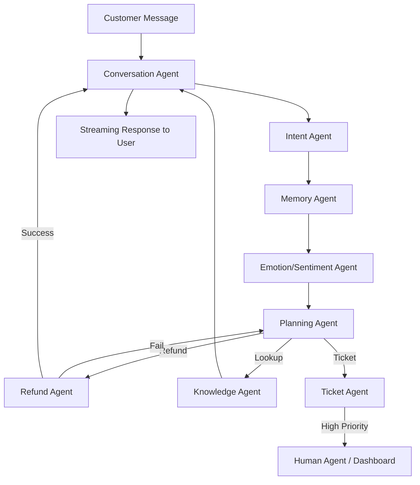

# Application Flow & Logic Maps

**Version:** 0.1.0
**Last Updated:** 2026-08-07

---

## 1. Primary Customer Journey (Happy Path: Refund)

1. **Greeting:**
   - Customer connects via Web Chat.
   - **Conversation Agent** greets: "Hi! I'm the support assistant. How can I help you today?"
   - **Memory Agent** runs in background: Loads customer profile (if authenticated).

2. **Intent Detection:**
   - Customer: "I want a refund on my order #12345, it arrived damaged."
   - **Intent Agent** classifies: `refund_request`.
   - **Sentiment Agent** scores: -0.4 (Frustrated).

3. **Context Loading:**
   - **CRM Agent** fetches order #12345: Status = "Delivered", Date = 10 days ago.
   - **Memory Agent** checks: Customer is a VIP.
   - **Knowledge Agent** checks: Refund policy is 30 days; damaged goods are always eligible.

4. **Processing:**
   - **Refund Agent** executes:
     - Validates policy.
     - Validates damage claim (requires photo? Yes, request it if not provided).
     - *If photo provided:* Processes refund.
     - *If no photo:* Asks for photo.
   - **Ticket Agent** creates ticket `TIX-998` (high priority due to VIP + angry sentiment).

5. **Resolution:**
   - Customer sends photo.
   - **Refund Agent** approves refund ($150.00).
   - **Conversation Agent** replies: "Your refund of $150 has been processed to your original payment method. You should see it within 3-5 business days. A ticket TIX-998 has been created for tracking."

6. **Closing:**
   - **Analytics Agent** records: Contained, CSAT prompt sent.

---

## 2. Escalation Flow (Angry Customer)

1. **Context:**
   - Customer: "I've been waiting for 3 hours and nobody helped me!"
   - **Sentiment Agent** score: -0.9 (Angry).
   - **Intent Agent** classifies: `complaint`.

2. **Evaluation:**
   - **Planning Agent** sees score < -0.7.
   - **Escalation Agent** triggers: "Human handoff required."

3. **Summary Generation:**
   - **Knowledge Agent** and **Conversation Agent** generate a 3-bullet summary of the last 5 minutes.
   - **Ticket Agent** auto-fills ticket with summary and transcript link.

4. **Handoff:**
   - **Conversation Agent** replies: "I see this is frustrating. Let me connect you with a human specialist immediately."
   - System notifies Human Support Dashboard.
   - Conversation is transferred to a human agent session.

---

## 3. Knowledge Retrieval Flow (RAG)

1. **Query:**
   - Customer: "How do I reset the firmware on my Model-X device?"
   - **Intent Agent** classifies: `technical_help`.

2. **Vector Search:**
   - **Knowledge Agent** takes the query.
   - Embeds the query using the local embedding model.
   - Queries Qdrant `kb_docs` collection (Hybrid Search).

3. **Synthesis:**
   - **Conversation Agent** receives top-3 relevant chunks.
   - **Conversation Agent** synthesizes the answer.
   - **Self-Correction:** Agent checks: "Did I hallucinate?" (Confidence check).

4. **Response:**
   - Agent provides answer with citations (source links).

---

## 4. Ticket Creation Flow

1. **Trigger:**
   - Auto: If intent is `complaint` or `escalation`.
   - Explicit: If AI cannot solve the problem after 3 attempts.

2. **Data Mapping:**
   - Ticket Agent maps `Conversation ID`, `Customer ID`, `Subject`, `Category`.

3. **Storage:**
   - Ticket created in Postgres `tickets` table.
   - Ticket ID returned to Conversation Agent for confirmation to the user.

---

## 5. Technical Diagram (LangGraph Nodes)

---

## 6. State Machine (Frontend)

| State | Description | UI |
|---|---|---|
| `idle` | Waiting for input | Text input, send button |
| `loading` | Processing | Typing indicator, skeleton text |
| `thinking` | Agent reasoning | "Searching knowledge base..." |
| `typing` | LLM streaming | Word-by-word appearance |
| `error` | System failure | "Something went wrong" banner |
| `transferred` | Human handoff | "You are now chatting with a human" |
